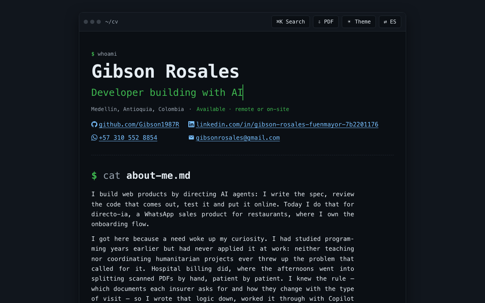

# cv-gibson

Mi currículum web, construido con apoyo de IA. Tres perfiles bilingües (español / inglés), con
estética de editor de código y sin una sola dependencia en el navegador.

El sitio permite elegir el perfil pertinente y guardar su versión en PDF.

## Perfiles y PDF

- `/?perfil=tecnologia&lang=es`: desarrollo web con IA y QA manual y asistido por IA.
- `/?perfil=talento-humano&lang=es`: Gestión de Talento Humano y administración.
- `/?perfil=docencia&lang=es`: licenciatura en Educación y experiencia docente.

Los tres enlaces de la cabecera abren páginas con URL propia. El idioma explícito
de la URL prevalece sobre la preferencia guardada; cambiar de perfil conserva el
idioma. Los enlaces anteriores sin perfil siguen abriendo Tecnología.

El botón **PDF** abre la impresión del perfil activo: elegir **Guardar como PDF**.
El nombre incluye perfil e idioma. Tecnología ocupa dos A4; Talento Humano y
Docencia, una A4 cada uno, según la validación local en Chromium. La paginación
puede variar en otros motores de impresión. La web conserva experiencia y
habilidades complementarias que se excluyen del PDF específico.

Las comprobaciones de extracción y del motor ATS local usan claves propias de
cada perfil; no garantizan compatibilidad con todos los sistemas de selección.

### ▶ Ábrelo: **<https://cv-gibson-rosales.netlify.app>**

Pulsa <kbd>⌘K</kbd> para la paleta de comandos, o el botón **EN/ES** para verlo
en inglés.

[](https://cv-gibson-rosales.netlify.app)

**Autor:** [Gibson Rosales](https://www.linkedin.com/in/gibson-rosales-fuenmayor) · [gibsonrosales@gmail.com](mailto:gibsonrosales@gmail.com)

> _Three CV profiles: bilingual, keyboard-driven, zero runtime dependencies,
> plain HTML, CSS and JavaScript. Switch the language with the **EN/ES** button
> or press <kbd>⌘K</kbd>._

---

## Por qué existe

Vengo de la docencia y de la administración, no de la informática. Un CV en PDF
dice lo que sé hacer; este dice cómo trabajo, porque hay que abrirlo y usarlo.

Me puse tres reglas y las cumplí:

1. **Cero dependencias en el navegador.** Ni frameworks, ni librerías, ni
   analítica, ni cookies. Vite se usa solo para levantar el servidor de
   desarrollo y compilar. Lo que llega al visitante es HTML, CSS y JS.
2. **Todo el contenido en un solo sitio.** Cambiar el CV es editar `data.js`.
   Ningún otro fichero contiene texto visible.
3. **Accesible de verdad, no de adorno.** Navegable entero con teclado,
   contraste AA medido en los dos temas, y las animaciones se apagan solas si
   el sistema pide menos movimiento.

## Qué hace

| | |
|---|---|
| **Bilingüe** | Botón **EN/ES**. Cambia el contenido, los botones y el atributo `lang` del documento — lo que hace que un lector de pantalla cambie de voz |
| **Paleta de comandos** | <kbd>⌘K</kbd> / <kbd>Ctrl</kbd>+<kbd>K</kbd>, como en un editor. Navega, cambia tema o idioma, copia el email, imprime |
| **Tema claro / oscuro** | Respeta `prefers-color-scheme` y recuerda tu elección |
| **Imprimir en PDF** | Una hoja de estilos de impresión aparte convierte la terminal en un CV clásico en serif, en el idioma activo |
| **Responsive** | Desde 320 px, sin scroll horizontal |

## Cómo lo ejecuto

```bash
npm install
npm run dev      # servidor de desarrollo
npm run build    # compila a dist/
npm run preview  # sirve dist/ para revisarlo antes de publicar
npm test         # perfiles, fechas, URLs e idioma sin dependencias adicionales
```

Requiere Node 22 o superior.

## Cómo se edita el contenido

Todo vive en **`data.js`**, en dos bloques con la misma estructura:

```js
export const CV_PROFILES = {
  es: { tecnologia, "talento-humano": talentoHumano, docencia },
  en: { tecnologia, "talento-humano": humanResources, docencia: teaching },
};
```

- `data.js` comparte puestos, titulaciones, proyectos y herramientas entre los
  perfiles para evitar versiones contradictorias de un mismo hecho.
- `PROFILE_CONTENT` selecciona títulos, resumen y secciones; `makeProfile`
  compone la vista. `CV_DATA.es`/`CV_DATA.en` mantienen el perfil tecnológico
  como vista predeterminada compatible con las referencias anteriores.
- Los textos de interfaz —botones, perfiles, paleta y etiquetas accesibles—
  viven en `SHARED.<idioma>.ui`.
- **Para cambiar un texto hay que editarlo en los dos bloques.**
- Si añades un texto visible nuevo y lo pones en `data.js`, queda bilingüe
  automáticamente: no hay que tocar `index.html` ni el JS.

Dos reglas de estructura que el código da por hechas:

- El `id` de cada entrada de `sections` tiene que coincidir con la clave de
  datos del mismo bloque (`id: "experience"` → `CV_DATA.es.experience`).
- Los `id` son **iguales en los dos idiomas** a propósito, para que un enlace
  compartido (`#experience`) funcione en ambos.
- Una sección o tarjeta con `soloWeb: true` conserva contexto en pantalla y no
  aparece en el PDF. Los textos `{ text, pdf }` mantienen el mismo hecho con
  una redacción más breve para impresión. `printBreak` marca el salto de página
  antes de los proyectos del perfil tecnológico.

Hay dos secciones de trayectoria y conviene no confundirlas: `experience` es la
experiencia en programación (tarjetas, sin fechas, ordenadas por impacto) y
`otherExperience` son los empleos anteriores (con fechas). La regla de
redacción de ambas está en [star.md](star.md).

## Cómo está montado

```
index.html          El armazón. No contiene texto del CV
data.js             TODO el contenido, en los dos idiomas
main.js             Orquestador: pinta y arranca las features
js/
  i18n.js           Decide qué idioma está activo. Sin textos dentro
  profiles.js       Resuelve el perfil y sus enlaces compartibles
  render.js         data.js → DOM. Un renderizador por tipo de sección
  palette.js        Paleta de comandos sobre un <dialog> nativo
  theme.js          Claro / oscuro
  motion.js         Aparición al hacer scroll
css/
  tokens.css        Variables de color, espaciado y tipografía
  base.css          Reset y elementos base
  layout.css        La "ventana" y la barra superior
  sections.css      Cabecera y secciones
  palette.css       El diálogo de comandos
  print.css         El CV en papel
```

Algunas decisiones que no se ven:

- **La paleta es un `<dialog>` nativo.** Trampa de foco, cierre con
  <kbd>Esc</kbd>, fondo inerte y `::backdrop` salen gratis. Una librería de
  modales habría costado kilobytes por lo mismo.
- **Cambiar de idioma repinta la página entera** en vez de traducir nodo por
  nodo. Es más simple y no puede dejar la mitad sin traducir.
- **El estado "oculto" del scroll-reveal lo pone el JavaScript, no el CSS.** Si
  el JS falla, el contenido se ve igual. Nunca se esconde texto esperando que
  algo lo devuelva.
- **El número de documento no está en el HTML.** Vive tras una bandera en
  `data.js` y solo se renderiza al imprimir: en una web pública, "oculto con
  CSS" no es oculto.

## Despliegue

Netlify compila con `npm run build` y publica `dist/`. La configuración está en
[`netlify.toml`](./netlify.toml), así que cualquier push a `main` despliega solo.

`vite.config.js` fija `base: "/"` porque Netlify sirve en la raíz del dominio.
Si el sitio se moviera a GitHub Pages como sitio de proyecto, ahí habría que
poner `"/nombre-del-repo/"` — es el fallo número uno al publicar Vite.
